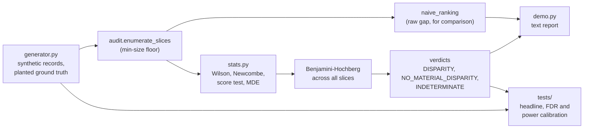

# sliceguard

Fairness slice auditing with Wilson intervals and Benjamini-Hochberg correction, so a 23-person slice stops manufacturing a crisis.

[](https://github.com/rchintala13/sliceguard/actions/workflows/ci.yml)

## Why

A fairness audit slices a model by a dozen attributes, finds one slice with a fourteen-point accuracy gap, and triggers a three-week investigation. The slice contains 23 people and the gap is noise. Meanwhile a genuine four-point gap on a slice of 40,000 people goes unmentioned because four points looks small next to fourteen. Ranking by raw point estimate rewards the smallest slices, because they have the fattest tails.

sliceguard puts an interval on every slice, corrects for the whole family of slices tested, ranks by the interval's lower bound, and reports a minimum detectable effect so that "nothing found" is never confused with "too few samples to tell".

## Features

- Slice enumeration up to a chosen interaction order (`max_order`; the default is 2, i.e. single attributes and pairs, and the demo sets `max_order=3` to include triples), with a validity floor of 10 rows.
- Wilson interval per slice accuracy and a Newcombe interval on the gap between a slice and the rest of the population.
- Benjamini-Hochberg control of the false discovery rate across every slice tested (default q = 0.05).
- Ranking by the lower bound of the gap interval rather than the point estimate.
- Minimum-detectable-disparity per slice. Slices that are not significant and are too small to rule out a material gap are reported as `INDETERMINATE`, never as fair.
- A synthetic evaluation-set generator with planted disparities of known size, so false discovery rate and power can be measured against ground truth.
- A side-by-side demo report: the generic raw-gap ranking next to the guarded one.

## Architecture



`audit()` takes a list of records, enumerates slices, computes each slice's gap against the complement, and tests all of them as one family. Verdicts are assigned per slice: a gap that survives BH is `DISPARITY`; a non-significant slice whose MDE is below the configured material threshold is `NO_MATERIAL_DISPARITY`; everything else is `INDETERMINATE`. The audit functions only need records with attributes and a correct/incorrect flag, so they run on real data unchanged.

## Quick start

Requires Python 3.11+. There is nothing to install: the code uses only the standard library.

```bash
git clone https://github.com/rchintala13/sliceguard.git
cd sliceguard
python -m src.demo                       # full report, a few seconds
python -m unittest discover -s tests -v  # full suite, about 15 seconds
```

## Example

`python -m src.demo` audits 6,000 synthetic underwriting-model evaluations with two planted 9-point disparities and prints the generic ranking, then the guarded one (trimmed):

```text
1. THE GENERIC REPORT -- rank slices by the raw accuracy gap
slice                                               n      gap   ground truth
region=east & age_band=45-59 & channel=phone       19   +16.2    noise  +2.4
region=south & age_band=60+ & channel=broker      116   +15.1    REAL   +7.8
region=south & age_band=60+ & channel=phone        10   +14.6    REAL   +7.7

2. THE GUARDED REPORT -- Wilson/Newcombe intervals + Benjamini-Hochberg
slice                                               n      gap     95% CI on gap     MDE  verdict
region=south & age_band=60+ & channel=broker      116   +15.1   [ +6.5,+24.8]   20.1  REAL   +7.8
region=south & age_band=60+ & prior=renewal       194   +12.3   [ +5.6,+19.9]   15.0  REAL   +7.9
region=south & age_band=60+                       333   +10.4   [ +5.1,+16.2]   11.0  REAL   +8.1

3. WHAT THE AUDIT COULD NOT HAVE FOUND -- the loud tiny slices
region=east & age_band=45-59 & channel=phone       19   +16.2   [ -0.9,+39.5]   49.4  INDETERMINATE

4. VERDICT COUNTS
  DISPARITY                       6   disparity survives BH correction
  NO_MATERIAL_DISPARITY           8   powered to rule out a 5-pt gap, none found
  INDETERMINATE                 186   insufficient evidence either way
  INDETERMINATE_BELOW_GATE        3   below the n=10 validity floor, not tested
```

The 19-person slice that tops the generic report is noise; the guarded report ranks genuinely disparate, well-populated slices first and marks the tiny one `INDETERMINATE`.

## How it works

- **Wilson interval** for each slice's accuracy; it keeps sensible coverage at small n and extreme p where the Wald interval collapses.
- **Newcombe interval** for the difference between the slice and the rest, built from the two Wilson intervals, with a **two-proportion score test** supplying the p-value that feeds BH.
- **Benjamini-Hochberg** over the full slice family. Slices overlap heavily (a cell and its parents), which is positive dependence, under which BH still controls FDR.
- **Minimum detectable disparity** from a normal approximation at 80% power: the smallest gap this slice could reliably have shown.
- **Ranking by lower bound** answers "how bad is it at least", not "what number did we happen to observe".

## Measured results

All numbers below are printed by `python -m src.demo` or asserted by the suite (48 tests; the suite runs in about 15 seconds). The generator plants a 9-point accuracy gap in two intersectional cells; every other slice differs by sampling noise only.

### The headline: what the two rankings put first

200 slices enumerated over 6,000 evaluation rows (seed 1).

| rank | generic report (raw gap) | n | gap | truth | guarded report (BH + lower bound) | n | gap | truth |
|---|---|---|---|---|---|---|---|---|
| 1 | east & 45-59 & phone | 19 | +16.2 | **noise (+2.4)** | south & 60+ & broker | 116 | +15.1 | real (+7.8) |
| 2 | south & 60+ & broker | 116 | +15.1 | real (+7.8) | south & 60+ & renewal | 194 | +12.3 | real (+7.9) |
| 3 | south & 60+ & phone | 10 | +14.6 | real (+7.7) | south & 60+ | 333 | +10.4 | real (+8.1) |
| 4 | 60+ & phone & new | 18 | +12.4 | **noise (+3.2)** | east & 45-59 & new | 159 | +10.7 | real (+7.8) |
| 5 | south & 60+ & renewal | 194 | +12.3 | real (+7.9) | east & new | 573 | +6.7 | real (+8.4) |

Across 40 independent evaluation sets (`tests/test_headline.py`):

| | point-estimate ranking | interval + BH ranking |
|---|---|---|
| top-ranked slice is noise | **52.5%** of audits | **7.5%** of audits |
| precision@5 | 0.565 | 0.915 |
| median n of the top-ranked slice | 26 | 333 |

### FDR under the null (300 simulated audits, 75 slices each, no disparity planted)

| | uncorrected | BH at q = 0.05 |
|---|---|---|
| audits raising at least one alarm | **79%** | **3.7%** |
| false disparity claims per audit | 2.15 | 0.06 |

The uncorrected count matches closed form: 75 tests x 0.05 / 2 (one
direction) = 1.88 expected, 2.15 measured. The BH rate sits inside the
nominal 5%.

### Power, and the honest negative result

Both planted cells carry the same 9-point gap. They do not behave the same:

| planted cell | n | published MDE | BH power (40 runs) |
|---|---|---|---|
| region=east & prior=new | ~600 | 7.9 pts | **0.95** |
| region=south & age_band=60+ | ~300 | 11.7 pts | **0.68** |

The audit says so in advance. The 300-row cell's minimum detectable
disparity (11.7 points) is larger than the gap actually planted in it
(9 points), so a third of the time the audit cannot see it -- and on every
one of those runs it reports **INDETERMINATE**, never "no disparity found".
That is the safety property: the miss is visible in the report.

### Wilson vs Wald, exact binomial coverage (not simulated)

| n | true p | Wilson coverage | Wald coverage |
|---|---|---|---|
| 20 | 0.90 | 0.957 | 0.876 |
| 30 | 0.95 | 0.939 | **0.782** |
| 50 | 0.86 | 0.938 | 0.926 |

At 0 correct out of 20 the 95% Wald interval is `[0.000, 0.000]` -- zero
width, excluding p = 0.10 under which that outcome has probability 0.12.
At 19 of 20 its upper bound is 1.04, a probability above one.

## Testing

```bash
python -m unittest discover -s tests -v
python -m unittest tests.test_headline -v      # naive vs guarded ranking
python -m unittest tests.test_calibration -v   # FDR and power under the null
```

- `tests/test_stats.py`: Wilson, Wald, Newcombe, score test, BH and MDE against closed forms and exact binomial coverage.
- `tests/test_audit.py`: slice enumeration and verdict logic.
- `tests/test_calibration.py`: on null datasets with no disparity, the false discovery rate stays at the nominal level; planted disparities are detected at the expected power.
- `tests/test_headline.py`: across 40 independent evaluation sets, the guarded ranking beats the point-estimate ranking.

## Project layout

```text
src/
  stats.py       interval, test, BH and MDE implementations
  audit.py       slice enumeration, verdicts, naive ranking
  generator.py   synthetic evaluation sets with planted disparities
  demo.py        the printed side-by-side report
tests/           unittest suite
docs/            architecture notes
```

## Limitations

- **Synthetic data only.** No loader for real datasets. Measuring
  realised FDR and power requires knowing the truth, which real data does
  not give you. The audit functions take a list of records and would run
  on real data unchanged.
- **Accuracy parity only.** Demographic parity, equalised odds and
  calibration-by-group are not implemented.
- **Newcombe and the score test are not identical procedures.** Measured
  over 4,000 random pairs they disagree 19% of the time, always in the
  conservative direction (interval straddles zero while p < 0.05). The
  audit never assumes they agree; ranking by the interval can only
  under-claim harm.
- **The MDE is a normal approximation** and is conservative at small n:
  simulating at the reported MDE detects the gap 87% (n=400) to 97%
  (n=20) of the time against the 80% design target. Conservative is the
  safe direction for this number, but it is not exact.
- **BH assumes the tests are not strongly negatively dependent.** Slices
  here overlap heavily (a cell and its parents), which is positive
  dependence, under which BH still controls FDR, and the measured 3.7%
  confirms it on this family. A different slice lattice would deserve
  re-measuring rather than assuming. (The demo's quicker 100-run version
  prints 81% uncorrected vs 5% BH, 1.98 vs 0.06 false claims per audit.)
- **`material_disparity` is a policy input, not a statistic.** It decides
  only whether a non-significant, adequately-powered slice reads as "no
  material disparity" or "insufficient evidence". Someone has to choose it.
- **Not a mitigation tool and not a compliance certification.** It measures; mitigation is a separate decision.
- **Standard library only.** The statistics are written out by hand (normal CDF via `math.erfc`) and are checked against closed forms and exact binomial coverage in the tests rather than against a reference package.

## License

MIT, see [LICENSE](LICENSE).

## Maintainer

Maintained by **Rohit Hari Chintala, Ph.D.**, Applied Scientist and AI/ML Engineer. Originally authored by Rohit, the project continues to be maintained with a focus on practical, statistically grounded fairness auditing.

- [GitHub](https://github.com/rchintala13)
- [LinkedIn](https://www.linkedin.com/in/rohit-chintala-768016103/)
- [Email](mailto:rohit.chintala@gmail.com)