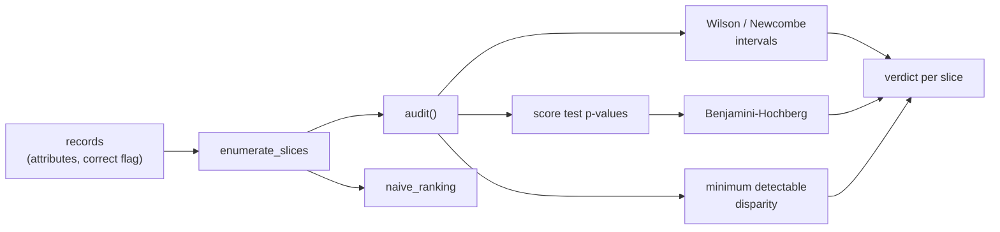

# Architecture

## Context

Fairness audits usually tabulate a metric per slice and sort by the raw gap. With a couple of hundred slices, the maximum of that list is dominated by the smallest, noisiest slices. sliceguard treats the slice family as one multiple-testing problem and reports what the data can and cannot support.

## Container view

Everything is plain Python in `src/`: `stats.py` holds the numerics, `audit.py` the slice logic and verdicts, `generator.py` the synthetic data with planted truth, and `demo.py` the printed report.

## Key decisions

- **Rank by the interval's lower bound.** The useful question is how bad a disparity is at least. Ranking by point estimate rewards small slices.
- **Correct across the whole family.** Every enumerated slice above the validity floor is one test in a single Benjamini-Hochberg pass at q = 0.05. The alternative, correcting per attribute, under-counts the real number of comparisons.
- **Report power, not just significance.** Each slice carries its minimum detectable disparity. A non-significant slice whose MDE exceeds the material threshold is `INDETERMINATE`, not "fair".
- **Synthetic data with planted truth.** Measuring false discovery rate and power requires knowing the right answer, which real data cannot provide.
- **Standard library only.** The normal CDF comes from `math.erfc`; there are no runtime dependencies to install.

## Failure modes

- Slices below 10 rows are not tested and are labelled `INDETERMINATE_BELOW_GATE`.
- Underpowered slices are reported as `INDETERMINATE`; a miss is visible in the report rather than silent.
- The MDE is a normal approximation and is conservative at small n.
- Newcombe intervals and the score test can disagree near the boundary; ranking by the interval can only under-claim harm.

## Out of scope

- Fairness mitigation.
- Compliance certification.
- Criteria other than accuracy parity (demographic parity, equalised odds, calibration by group).
- Real-dataset loaders.
